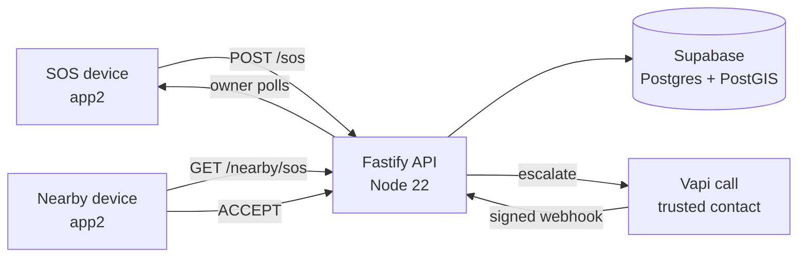
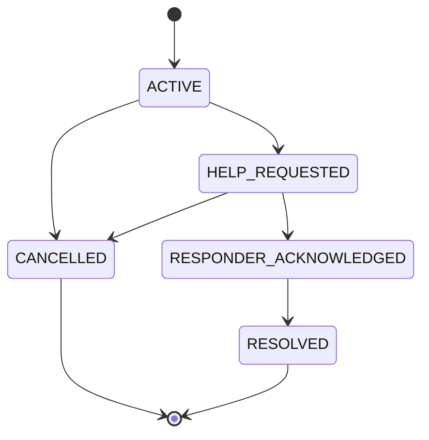

<div align="center">


<h1 align="center">LexNova</h1>

<p align="center"><strong>A safety net where every phone can ask for help and answer a call for help — no account, no password, no fixed role.</strong></p>

<a href="#getting-started"></a>
<a href="#what-is-real-simulated-and-next"></a>


<br>

**[API reference](server/README.md)** · **[Android client](app2)** · **[Judge path](#try-it-in-30-seconds)** · **[Security](#security-privacy-and-ethics)**

<sub>Team LexNova · Hackathon HK26-0040 · Problem statement SS-01 — Personal Safety &amp; Emergency Response</sub>

</div>


## Table of contents

[Problem](#problem) · [Solution](#solution) · [Why it is different](#why-it-is-different) · [Try it in 30 seconds](#try-it-in-30-seconds) · [Features](#features) · [How it works](#how-it-works) · [Tech stack](#tech-stack) · [Impact and feasibility](#impact-and-feasibility) · [How it maps to the judging brief](#how-it-maps-to-the-judging-brief) · [What is real, simulated and next](#what-is-real-simulated-and-next) · [Getting started](#getting-started) · [Usage](#usage) · [Security, privacy and ethics](#security-privacy-and-ethics) · [Team](#team) · [License](#license)

## Problem

Many safety apps ask you to pick a side before anything happens: register as a helper, or as someone who needs help. That choice creates the friction — an account, a password, a role you did not have time to select — at exactly the moment a person has the least attention to spare. And when an alert does go out, a nearby stranger often receives a location pin rather than a decision they can act on.

**Evidence:** WHO's 2023 estimate is that about **1 in 3 women (31.6%)** worldwide have experienced physical and/or sexual intimate partner violence, non-partner sexual violence, or both, in their lifetime — [WHO fact sheet](https://www.who.int/news-room/fact-sheets/detail/violence-against-women). LexNova is not limited to one threat model: the same incident path covers medical, road and harassment emergencies, because the person asking for help decides what counts.

LexNova starts from the other assumption: **every device is both a potential caller and a potential responder**, and the role is decided by the incident, not by an account profile.

## Solution

One server-owned incident becomes the single source of truth. A device asks for help in one tap or five shakes; the API validates the transition, finds opted-in devices nearby, alerts them, and escalates when nobody accepts.

- **Identity without signup** — a UUID in `X-Device-Id`, auto-registered on first request. No password, email or account type exists in the schema.
- **Responder is a membership, not a user type** — the same device can be the person in danger in one incident and an accepted responder in another.
- **Privacy before contact** — nearby devices see a 2 km radius and a distance rounded to 100 m; exact coordinates appear only after a responder accepts.
- **A trigger that survives a locked screen** — five shakes creates the SOS, posts location and dials the configured line.
- **Status you can audit** — delivery, acknowledgement and acceptance are stored as separate facts, so "alerted" is never shown as "on the way".

## Why it is different

| Need | A conventional safety app | **LexNova** |
|:--|:--|:--|
| Getting started | Sign up, verify, choose a role | Device UUID, auto-registered |
| Who can respond | Broadcast to everyone, or a paid guard service | Opted-in devices within 2 km, membership per incident |
| Location privacy | Exact pin sent to the area | 100 m rounded until `ACCEPTED` |
| Evidence of help | Optimistic "help is on the way" copy | Separate delivery, acknowledgement and acceptance records |
| Trigger | Unlock, open app, hold a button | 5 shakes on the lock screen, or one tap in the app |
| Roles | Fixed helper or victim | Both, derived per incident |

## Try it in 30 seconds

**There is no hosted demo and no screenshots are committed yet.** The full loop needs two Android devices; the server path below is the fastest verified route and needs no Supabase or Vapi account.

1. **Start the API** (Node.js 22.12 or newer):

   ```bash
   git clone https://github.com/piyush-kumar499/LexNova-HK26-0040.git
   cd LexNova-HK26-0040/server
   npm ci
   cp .env.example .env
   npm run dev
   ```

2. **Prove it is alive and identity works** — in a second terminal:

   ```bash
   curl -s http://localhost:8080/health
   # {"status":"ok","time":"..."}

   DEVICE=$(uuidgen)
   curl -s -H "X-Device-Id: $DEVICE" http://localhost:8080/device/me
   # a device row is created on first contact; no signup step exists
   ```

3. **Run the evidence** — 125 tests, no external account required:

   ```bash
   npm test        # 14 files, 125 tests
   npm run typecheck
   ```

4. **Full two-device demo (~10 minutes)** — create a Supabase project and run the three migrations in order, put the server URL into app2's Settings, install the debug build on two phones with responder opt-in enabled, then shake five times on the locked SOS device. The responder phone rings over its lock screen and both incident screens update after `ACCEPT`.

The development tunnel URL and demo dial number shipped in `app2/.../Prefs.kt` are development values meant for local testing; replace both before distributing a build.

## Features

| Feature | What it does | Code |
|:--|:--|:--|
| **Device identity, no login** | Validates and reloads `X-Device-Id` on every request; unknown devices auto-register. A client-supplied role is never trusted. | [`deviceAuth.ts`](server/src/middleware/deviceAuth.ts) |
| **SOS lifecycle** | `POST /sos` creates an incident; only legal transitions are accepted, otherwise `409`. Idempotent replays return the same incident. | [`sos.service.ts`](server/src/services/sos.service.ts) |
| **Nearby responders** | Active incidents within a configurable radius (2 km default), ordered by distance, with no victim coordinates in the payload. | [`nearby.service.ts`](server/src/services/nearby.service.ts) |
| **Per-incident membership** | Accept, decline, go en route, arrive or withdraw — all recorded per responder, per incident, with timestamps. | [`0001_init.sql`](server/migrations/0001_init.sql) |
| **Escalation chain** | Trusted contacts in priority order, then a wider nearby radius, driven by a watchdog on unanswered attempts. | [`escalation.service.ts`](server/src/services/escalation.service.ts) |
| **Call webhooks** | HMAC/bearer-verified Vapi status and transcript intake; unattributable call references are quarantined. | [`vapi.service.ts`](server/src/services/vapi.service.ts) |
| **Lock-screen shake SOS** | Five shakes with the screen off or locked trigger the incident and the call; an unlocked screen gets a cancel countdown. | [`ShakeGuardService.kt`](app2/src/main/java/com/lexnova/safety/sensors/ShakeGuardService.kt) |
| **Responder alert over the lock screen** | A foreground service polls nearby incidents; a match rings, vibrates and opens a full-screen Accept/Decline alert. | [`NearbyAlertService.kt`](app2/src/main/java/com/lexnova/safety/sensors/NearbyAlertService.kt) |
| **Trusted contacts** | Add, list and remove contacts in call order; phone numbers are normalized to `+digits`. | [`contacts.ts`](server/src/routes/contacts.ts) |

## How it works

The app never touches the database. It calls the API with its device ID; the API holds the service-role key, checks incident membership, and returns only the fields that viewer may see. Webhooks are acknowledged immediately and processed in the background.



**The hard parts we actually solved**

- **Authorization is derived, not asserted.** Ownership and responder membership are recomputed from the device header on every request; a device without a membership row receives `403 NOT_A_RESPONDER`.
- **One incident, two lifecycles.** The incident state machine and each responder's own path are separate records, so "acknowledged", "accepted" and "arrived" cannot be conflated.
- **Mocks announce themselves.** Without Vapi keys the provider stores `provider: "mock"` and logs every simulated call as `MOCKED`. Nothing claims a real call happened.

<details>
<summary><strong>Incident state machine</strong> (click to expand)</summary>



A responder's membership moves independently: `NOTIFIED → ACCEPTED → EN_ROUTE → ARRIVED`, or `DECLINED` / `WITHDRAWN`. The incident record owns the overall state; the membership record owns that person's participation.

</details>

## Tech stack

| Layer | Choice | Why this one |
|:--|:--|:--|
| Android client | Kotlin 2.0.21, Jetpack Compose, Material 3, OkHttp | Foreground services and full-screen intents are first-class; one Compose codebase for Home, incident, nearby, contacts and settings |
| API | Node 22, Fastify 5, TypeScript strict | Small surface, fast startup, and `app.inject()` lets every route be tested without a socket |
| Validation | Zod 4 | Schemas are parsed at the edge; a malformed body never reaches a service |
| Database | Supabase Postgres + PostGIS | Spatial filtering close to the data, plus a service-role-only access model |
| Logs | pino | Structured request and escalation logs, redaction-ready |
| Voice | Vapi REST + signed webhook | Real phone calls without owning telephony infrastructure; mock provider when keys are absent |
| Tests | Vitest 5 | 14 files, 125 tests, no Supabase or Vapi account needed (Node 22.12+ required) |
| Deploy | Render blueprint (`render.yaml`) | One service, one health check; the blueprint is committed, the deployment is not verified |
| Legacy client | `app/` scaffold | Early Compose base whose API client targets a different, unbuilt API shape — not the demo client |

## Impact and feasibility

**Who it helps:** a person in danger who has a phone but not the time to unlock it, and a nearby person willing to help who will never install a "volunteer responder" app with a separate account.

| Question | Answer |
|:--|:--|
| Reach | Any Android phone with the app; no account, no invite, no device pairing. |
| Cost to run | Supabase and Render free tiers carry the prototype; Vapi is usage-priced and only used when real calls are enabled. |
| Main latency | The responder app polls every 15 seconds. FCM push is the obvious next step and is not built. |
| Failure path | Nobody accepts → next trusted contact → wider nearby radius, capped at three escalation levels. |
| Abuse and false alarms | Owner cancel and resolve transitions, 30 requests/minute per device, idempotent SOS creation, and append-only audit rows. |
| Biggest risk | A safety product that overstates its coverage. LexNova never claims police, ambulance or guard dispatch. |

A pilot is **designed but not run**: 50 opted-in devices over two weeks, measuring time-to-first-notification, responder acceptance rate and false-alarm rate. Those numbers do not exist yet, and this README does not pretend they do.

## How it maps to the judging brief

The official rubric is not published in this repository, so this table maps the SS-01 requirements recorded in the project brief to evidence that ships here.

| Brief requirement | Evidence in this repository |
|:--|:--|
| SOS with location and a validated lifecycle | `POST /sos`, state machine in `sos.service.ts`, tests for illegal transitions |
| Dynamic roles, no account-level helper | `incident_responders` membership, per-incident authorization tests |
| Nearby discovery without exposing the victim | `/nearby/sos`, 100 m rounding, coordinates after `ACCEPTED` only |
| Escalation when nobody accepts | Trusted contacts → wider radius, watchdog, mock Vapi, tested |
| Trusted contacts | `GET/POST/DELETE /contacts`, priority order, device isolation |
| Frictionless identity | `X-Device-Id` auto-registration, no passwords |
| Honest notification status | Delivery, acknowledgement and acceptance stored separately |
| Voice uplink | app2 dials the configured line on SOS; webhook intake is mock-first |
| No fabricated dispatch or AI claims | No police/ambulance integration; Groq analysis is marked planned |

## What is real, simulated and next

| Status | Item |
|:--:|:--|
| ✅ | Fastify API: 15 HTTP routes, device identity, rate limits, idempotency, audit |
| ✅ | SOS state machine, viewer-scoped responses, responder membership, contacts |
| ✅ | PostGIS nearby discovery with an in-memory twin, and 125 passing tests on Node 22.23.4 |
| ✅ | app2: SOS, lock-screen shake trigger, nearby lock-screen alert, dial, contacts, settings |
| 🔶 | app2 on-device validation — code exists, but no device run or Android test result is recorded here |
| 🔶 | Real Vapi calls — adapter and webhook exist; the provider stays mock without keys |
| 🔶 | Supabase project — migrations are written, but no project is linked in this repository |
| 🔶 | Render deployment — blueprint committed, no public deployment verified |
| 🧭 | Groq transcript analysis — named in the brief, no implementation in this repository |
| 🧭 | FCM push, WebRTC, Maps, private evidence storage, retention and deletion policy, iOS |

## Getting started

**Prerequisites:** Node.js **22.12+** (the real floor for Vitest 5, even though `package.json` still declares `>=20`), npm, and optionally Android Studio with JDK 17 and Android SDK 34. Supabase and Vapi are optional in development.

```bash
git clone https://github.com/piyush-kumar499/LexNova-HK26-0040.git
cd LexNova-HK26-0040/server
npm ci
cp .env.example .env
npm run dev
```

Without Supabase credentials the server runs on an in-memory database and warns loudly that data is lost on restart. Without Vapi credentials it runs on the mock call provider. `NODE_ENV=production` refuses to boot without Supabase.

```bash
npm run typecheck   # passes
npm test            # 14 files, 125 tests
npm run build       # tsc to dist/
npm start           # node dist/index.js
```

**Android client**

```bash
# Android Studio, JDK 17 and SDK 34 installed
./gradlew :app2:assembleDebug
```

Open app2's Settings and set the server URL before use. The client requests internet, fine/coarse location, phone, vibrate, notifications and full-screen-intent permissions — **no camera, microphone, contacts or SMS**.

<details>
<summary><strong>Configuration</strong> — environment variables</summary>

`server/.env.example` is the source of truth (19 keys). The important ones:

| Variable | Required | Default or note |
|:--|:--:|:--|
| `PORT` · `NODE_ENV` | no | `8080` · `development`; production requires Supabase |
| `SUPABASE_URL` · `SUPABASE_SERVICE_ROLE_KEY` | prod | Server-only credentials; empty means in-memory DB in development |
| `SUPABASE_ANON_KEY` | no | Present in the template; the app never calls Supabase directly |
| `VAPI_PRIVATE_KEY` · `VAPI_PUBLIC_KEY` | no | Without the private key the call adapter stays mock |
| `VAPI_PHONE_NUMBER_ID` · `VAPI_ASSISTANT_ID` | no | Select the number and assistant used for calls |
| `VAPI_WEBHOOK_SECRET` | no | Enables webhook signature verification |
| `NGROK_URL` | no | Public tunnel referenced in the Vapi dashboard webhook URL |
| `LOG_LEVEL` | no | `info` |
| `RATE_LIMIT_WINDOW_MS` · `RATE_LIMIT_MAX` | no | `60000` ms · 30 requests |
| `NEARBY_RADIUS_METERS` · `NEARBY_MAX_RESULTS` | no | `2000` m · 50 incidents |
| `SOS_ESCALATION_TIMEOUT_SECONDS` · `SOS_MAX_ESCALATION_LEVEL` | no | `60` s · 3 levels |
| `MOCK_VAPI_OUTCOME` | no | `answered`, `no-answer` or `silent` |

Every value in `.env.example` is a placeholder. Never commit a real key, token or transcript.

</details>

<details>
<summary><strong>API reference</strong> — 15 routes</summary>

Personal routes require `X-Device-Id` as a UUID header. `/`, `/health` and `/vapi/webhook` are public (the webhook still verifies its signature).

**Device and health**

| Method | Endpoint | Auth | Purpose |
|:--|:--|:--:|:--|
| `GET` | `/` | public | Service name and status |
| `GET` | `/health` | public | Liveness probe |
| `GET` | `/device/me` | device | Profile; unknown devices auto-register |
| `PATCH` | `/device/me` | device | Display name, phone, responder opt-in |
| `POST` | `/device/location` | device | Latest location (one row per device) |

**Incidents**

| Method | Endpoint | Auth | Purpose |
|:--|:--|:--:|:--|
| `POST` | `/sos` | device | Idempotent SOS creation via `clientRequestId` |
| `GET` | `/sos/:incidentId` | device | Owner view, or responder-scoped view |
| `POST` | `/sos/:incidentId/cancel` | owner | False-alarm cancel |
| `POST` | `/sos/:incidentId/resolve` | owner | Resolve after acknowledgement |
| `POST` | `/sos/:incidentId/respond` | device | `ACCEPT`, `DECLINE`, `EN_ROUTE`, `ARRIVED`, `WITHDRAW` |

**Contacts, nearby and voice**

| Method | Endpoint | Auth | Purpose |
|:--|:--|:--:|:--|
| `GET` | `/contacts` | device | Trusted contacts in call order |
| `POST` | `/contacts` | device | Add a contact; phone normalized to `+digits` |
| `DELETE` | `/contacts/:contactId` | device | Remove a contact |
| `GET` | `/nearby/sos` | device | Active incidents nearby; rounded distance only |
| `POST` | `/vapi/webhook` | signature | Call status, transcript and recording intake |

</details>

<details>
<summary><strong>Project layout</strong></summary>

```text
lexnova/
├── server/                 Fastify API, tests and database migrations
│   ├── src/routes/         15 HTTP routes
│   ├── src/services/       SOS state machine, escalation, nearby, Vapi
│   ├── src/middleware/     device auth, rate limit, idempotency, errors
│   ├── tests/              14 Vitest files, 125 tests
│   └── migrations/         tables, functions, deny-all RLS
├── app2/                   Kotlin + Compose client (the demo client)
├── app/                    early SafeAlert scaffold (not the demo client)
├── render.yaml             Render blueprint for the API service
└── settings.gradle.kts     includes :app and :app2
```

</details>

## Usage

**If you are in danger:** open app2, allow location, and press SOS — or shake five times on a locked screen. The incident is created, your latest location is stored, and the configured emergency line is dialled. The incident screen keeps polling and offers cancel or resolve.

**If a nearby SOS reaches you:** the alert rings over the lock screen. Accepting adds you to that incident only; you then move through `EN_ROUTE → ARRIVED`, or withdraw at any point. Exact location appears after acceptance, never before.

## Security, privacy and ethics

- **Deny-all database access.** `0003_rls.sql` enables Row Level Security with zero policies and revokes table access from `anon` and `authenticated`; only the server's service-role key reads or writes a row.
- **Identity cannot be claimed.** `X-Device-Id` is validated and reloaded server-side; incident ownership and responder membership are re-derived on every request.
- **Scope follows the membership row.** Exact location is released only after `ACCEPTED`; responders never see evidence or call detail.
- **Webhook authenticity.** Payloads are verified with HMAC-SHA256 or the documented bearer header using a constant-time compare. Calls that cannot be attributed are quarantined, not guessed onto an incident.
- **Abuse controls.** 30 requests/minute per device on mutating routes, idempotent SOS creation and call attempts, append-only audit trails.
- **What the app does not collect.** app2 requests no camera, microphone, contacts or SMS access. Proctoring-style recording does not exist here.
- **What is not hardened yet.** Retention and deletion policy, private evidence storage, TLS-only app traffic, key rotation and Play-policy review remain open. LexNova assists and informs; it does not dispatch police, an ambulance or a guard service.

## Team

| Person | Contribution in this repository |
|:--|:--|
| Mohd Ismail · [@ismailmo9090-del](https://github.com/ismailmo9090-del) | Server foundation, SOS/responder/contacts/escalation, Vapi webhook, app2 client, documentation |
| Piyush Chaurasiya · [@piyush-kumar499](https://github.com/piyush-kumar499) | Repository owner, SafeAlert Compose base, Gradle and build fixes |

## License

No `LICENSE` file is included. This is a hackathon submission for HK26-0040; contact the maintainers before reuse or redistribution.


<p align="center"><sub>LexNova · HK26-0040 · SS-01 — built for the moment when the nearest person is the best responder.</sub></p>
