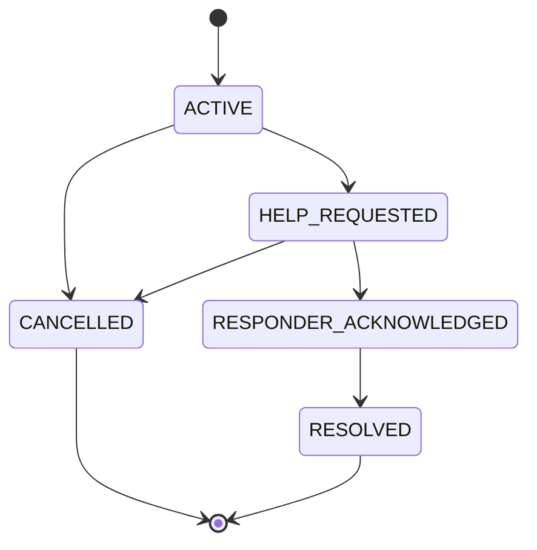
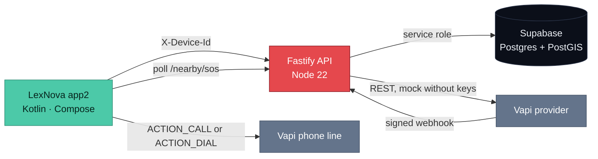

<div align="center">


<h1 align="center">LexNova</h1>

<p align="center"><strong>A safety net where every device can ask for help and answer a call for help — with no helper account and no login.</strong></p>

<a href="https://github.com/piyush-kumar499/LexNova-HK26-0040"></a>
<a href="https://github.com/piyush-kumar499/LexNova-HK26-0040#readme"></a>
<a href="#quickstart"></a>


<br><br>


</div>


<div align="center">

| Resource | Where |
|:--|:--|
| Server and API reference | [`server/README.md`](server/README.md) |
| Run the backend | [Quickstart](#quickstart) |
| Android client | [`app2/`](app2) |
| Security model | [Security](#security) |
| Test evidence | [Testing](#testing) |

</div>


<h2 align="center">What it does</h2>

- **Registers the device, not the person.** First launch creates a UUID, sent as `X-Device-Id`; the server auto-registers it. There is no signup, password or account type.
- **Turns one SOS into a server-owned incident.** `POST /sos` records the trigger, time and location, and the server enforces the state machine — an illegal transition is rejected with `409`, not ignored.
- **Finds nearby people who opted in to respond.** `GET /nearby/sos` returns active incidents within a 2 km default radius, with distance rounded to 100 m and no victim coordinates.
- **Makes the responder decision per incident.** Any device can be the person in danger in one incident and an accepted responder in another; membership lives in `incident_responders`, never on the device profile.
- **Keeps the phone useful when it is locked.** The app2 client watches for 5 shakes while the screen is off or locked, creates the SOS, posts location and dials the configured emergency line.
- **Records what actually happened.** Delivery, acknowledgement and acceptance are stored as separate facts, with append-only `audit_logs` and `responder_events`.

<h2 align="center">The problem</h2>

| Safety apps today | With LexNova |
|:--|:--|
| You register as a "helper" or a person who needs help | ✗ Account types; ✓ role is derived per incident |
| Live coordinates go to everyone in the area | ✗ Broadcast; ✓ 100 m rounded distance, exact location only after `ACCEPTED` |
| The UI says "help is on the way" without proof | ✗ Copy as evidence; ✓ delivery, acknowledgement and acceptance stored separately |
| Calling for help needs the phone unlocked and full attention | ✗ Manual only; ✓ 5-shake lock-screen trigger plus a one-tap SOS button |
| Sign-up friction stands between a person and an SOS | ✗ Forms and passwords; ✓ device identity, auto-registration |

<h2 align="center">Why it is different</h2>

<table>
<tr>
<td align="center" width="50%">

<h3>A conventional safety app</h3>


</td>
<td align="center" width="50%">

<h3>LexNova</h3>


</td>
</tr>
</table>

<h2 align="center">Features</h2>

<table>
<tr>
<td align="center" width="33%">

<h3>SOS with a real state machine</h3>

`ACTIVE → HELP_REQUESTED → RESPONDER_ACKNOWLEDGED → RESOLVED`, plus `CANCELLED`. Transitions are validated in the service layer and covered by tests.


</td>
<td align="center" width="33%">

<h3>Nearby responder alert</h3>

A foreground service polls every 15 s; a nearby SOS rings, vibrates and opens a full-screen alert over the lock screen with Accept and Decline.


</td>
<td align="center" width="33%">

<h3>Shake-to-SOS</h3>

Five shakes with the screen off or locked create the incident and place the call. On an unlocked screen the app shows a 5-second cancel countdown first.


</td>
</tr>
<tr>
<td align="center" width="33%">

<h3>Trusted contacts and escalation</h3>

Contacts are called in priority order; no answer moves to the next contact, then a wider nearby radius, with a watchdog on silent attempts.


</td>
<td align="center" width="33%">

<h3>Device identity, no login</h3>

A UUID header is validated and re-derived on every request. A client-supplied role or owner ID is never trusted.


</td>
<td align="center" width="33%">

<h3>Audit and privacy</h3>

Append-only audit tables, deny-all RLS, service-role-only database access, and coordination withheld until a responder accepts.


</td>
</tr>
</table>

<h2 align="center">The SOS flow</h2>



The incident record owns this state. A responder's own path (`NOTIFIED → ACCEPTED → EN_ROUTE → ARRIVED`, or `DECLINED` / `WITHDRAWN`) is a separate membership record, so "accepted" is never reported as "arrived".

<h2 align="center">Architecture</h2>



The app never talks to the database: it calls the API with its device ID. The API holds the service-role key, evaluates membership per incident, and returns only the fields that viewer is allowed to see. Webhooks are acknowledged immediately and processed in the background.

<h2 align="center">Tech stack</h2>

| Layer | Technology | Role in LexNova |
|:--|:--|:--|
| Android client | Kotlin 2.0.21, Compose BOM 2024.10.01, Material 3, OkHttp | SOS, nearby responder flow, contacts, settings, foreground services |
| Server | Node 22, Fastify 5, TypeScript strict, Zod 4, pino | 15 route handlers, validation, rate limits, state machines |
| Data | Supabase Postgres + PostGIS | 10 tables, spatial index, deny-all RLS |
| Voice | Vapi REST + signed webhook | Mock-first call adapter; real provider needs keys and a number |
| Tests | Vitest 5 | 14 files, 125 tests, no Supabase or Vapi account needed |
| Deploy | Render blueprint (`render.yaml`) | API service only; not verified as deployed |
| Legacy client | `app/` (SafeAlert scaffold) | Early Compose base; its Retrofit client targets a different, unbuilt API shape |

<h2 align="center">API reference</h2>

Every route is served by `server/src`; personal routes require `X-Device-Id` as a UUID header. `/`, `/health` and `/vapi/webhook` are public.

### Device and health

| Method | Endpoint | Auth | Purpose |
|:--|:--|:--:|:--|
| `GET` | `/` | public | Service name and status |
| `GET` | `/health` | public | Liveness probe |
| `GET` | `/device/me` | device | Profile; unknown devices auto-register |
| `PATCH` | `/device/me` | device | Display name, phone, responder opt-in |
| `POST` | `/device/location` | device | Latest location (one row per device) |

### Incidents

| Method | Endpoint | Auth | Purpose |
|:--|:--|:--:|:--|
| `POST` | `/sos` | device | Idempotent SOS creation via `clientRequestId` |
| `GET` | `/sos/:incidentId` | device | Owner view, or responder-scoped view |
| `POST` | `/sos/:incidentId/cancel` | owner | False-alarm cancel |
| `POST` | `/sos/:incidentId/resolve` | owner | Resolve after acknowledgement |
| `POST` | `/sos/:incidentId/respond` | device | `ACCEPT`, `DECLINE`, `EN_ROUTE`, `ARRIVED`, `WITHDRAW` |

### Contacts, nearby and voice

| Method | Endpoint | Auth | Purpose |
|:--|:--|:--:|:--|
| `GET` | `/contacts` | device | Trusted contacts in call order |
| `POST` | `/contacts` | device | Add a contact; phone normalized to `+digits` |
| `DELETE` | `/contacts/:contactId` | device | Remove a contact |
| `GET` | `/nearby/sos` | device | Active incidents nearby; rounded distance only |
| `POST` | `/vapi/webhook` | signature | Call status, transcript and recording intake |

<h2 align="center">Security</h2>

- **Deny-all database access.** `0003_rls.sql` enables RLS with zero policies and revokes table access from `anon` and `authenticated`; only the server's service-role key reads or writes a row.
- **Identity cannot be claimed.** `X-Device-Id` is validated and reloaded server-side; incident ownership and responder membership are re-derived from it on every request.
- **Scope follows the membership row.** A responder sees exact location only after `ACCEPTED` and never sees evidence or call detail; a device without a membership row gets `403 NOT_A_RESPONDER`.
- **Webhook authenticity.** Vapi payloads are verified with HMAC-SHA256 or the documented bearer header using a constant-time compare; unattributable call references are quarantined, not guessed onto an incident.
- **Abuse controls.** 30 requests/minute per device on mutating routes, idempotent SOS creation and call attempts, and append-only audit trails.
- **Not production-hardened yet.** Retention and deletion policy, private evidence storage, TLS-only app traffic and Play-policy review are still open; see [Honest notes](#honest-notes).

<h2 align="center">Quickstart</h2>

Prerequisites: **Node.js 22.12 or newer** (Vitest 5 refuses Node 20) and npm. Supabase and Vapi are optional for development: without them the server runs on an in-memory database and the mock call provider.

```bash
git clone https://github.com/piyush-kumar499/LexNova-HK26-0040.git
cd LexNova-HK26-0040/server
npm ci
cp .env.example .env
npm run dev
```

Open `http://localhost:8080/health`. Verified in this repository's environment: the server boots without keys, `/health` returns `{"status":"ok"}`, `npm run typecheck` passes, and the suite runs 125 tests across 14 files.

```bash
npm run typecheck
npm test
npm run build && npm start
```

### Database and webhooks

1. Run `server/migrations/0001_init.sql`, then `0002_functions.sql`, then `0003_rls.sql` in the Supabase SQL editor — in that order.
2. Set `SUPABASE_URL` and `SUPABASE_SERVICE_ROLE_KEY` in `.env`. Production refuses to boot without them.
3. For call webhooks, expose the server with ngrok, set `NGROK_URL`, and point the Vapi dashboard at `NGROK_URL/vapi/webhook`. Free ngrok URLs change on every restart.

<h2 align="center">Environment variables</h2>

| Variable | Required | Default or note |
|:--|:--:|:--|
| `PORT` | no | `8080` |
| `NODE_ENV` | no | `development`; `production` requires Supabase |
| `SUPABASE_URL` · `SUPABASE_SERVICE_ROLE_KEY` | prod | Server-only credentials; empty means in-memory DB in development |
| `SUPABASE_ANON_KEY` | no | Present in the template; the app never uses Supabase directly |
| `VAPI_PRIVATE_KEY` · `VAPI_PUBLIC_KEY` | no | Without the private key the call adapter stays mock |
| `VAPI_PHONE_NUMBER_ID` · `VAPI_ASSISTANT_ID` | no | Select the number and assistant used for calls |
| `VAPI_WEBHOOK_SECRET` | no | Enables webhook signature verification |
| `NGROK_URL` | no | Public tunnel used in the Vapi dashboard |
| `LOG_LEVEL` | no | `info` |
| `RATE_LIMIT_WINDOW_MS` · `RATE_LIMIT_MAX` | no | `60000` ms · 30 requests |
| `NEARBY_RADIUS_METERS` · `NEARBY_MAX_RESULTS` | no | `2000` m · 50 incidents |
| `SOS_ESCALATION_TIMEOUT_SECONDS` · `SOS_MAX_ESCALATION_LEVEL` | no | `60` s · 3 levels |
| `MOCK_VAPI_OUTCOME` | no | `answered`, `no-answer` or `silent` |

All values in `server/.env.example` are placeholders. Never commit a real key, token or transcript.

<h2 align="center">Usage</h2>

**If you are in danger:** open app2, allow location, and press SOS — or shake five times on a locked screen. The incident is created, your latest location is stored, and the configured emergency line is dialled. The incident screen keeps polling and offers cancel or resolve.

**If a nearby SOS reaches you:** the alert rings over the lock screen. Accepting adds you to that incident only; you then move through `EN_ROUTE → ARRIVED`, or withdraw at any point. Exact location appears after acceptance, never before.

<h2 align="center">Android client</h2>

`app2/` is the client that talks to this server: a single-activity Compose app with Home, Active incident, Nearby, Contacts and Settings screens, plus two foreground services (shake guard, nearby alert polling). It needs `CALL_PHONE`, fine location, notifications, full-screen intent and special-use foreground-service permissions.

```bash
# with Android Studio, JDK 17 and Android SDK 34 installed
./gradlew :app2:assembleDebug
```

Set the server URL in Settings before using it. The repository ships a development tunnel URL and a demo dial number in `app2/.../Prefs.kt`; replace both before distributing a build. The `app/` module is an earlier SafeAlert scaffold whose API client calls endpoints (`/emergencies`, `/checkins`, `/places`) that this server does not implement — it is not the demo client.

<h2 align="center">Testing</h2>

```bash
cd server
npm test        # 14 files, 125 tests — mock database, mock provider, no keys
```

Verified on Node 22.23.4: **14 test files, 125 tests passing**. The suite covers the incident state machine and owner isolation, idempotent SOS and call attempts, responder membership transitions, contacts, PostGIS-equivalent nearby filtering with the 100 m floor, the escalation chain and watchdog, webhook signature handling and quarantine, and the 13 critical-path scenarios from the brief. Tests use Fastify `app.inject()` and never place a real call. Android tests are not part of this result: `app2/` has none, and no device run is recorded in the repository.

<h2 align="center">Status and roadmap</h2>

| Status | Item |
|:--:|:--|
| ✅ | Fastify API: 15 routes, device identity, rate limits, idempotency, audit |
| ✅ | SOS state machine, per-viewer scoping, responder membership, contacts |
| ✅ | PostGIS nearby discovery with an in-memory twin and 125 passing tests |
| ✅ | app2 client: SOS, nearby lock-screen alert, 5-shake trigger, dial, contacts |
| 🔶 | app2 on-device validation — built but not verified on a physical device here |
| 🔶 | Real Vapi calls — adapter and webhook exist, provider stays mock without keys |
| 🔶 | Render deployment — blueprint committed, no public deployment linked |
| 🧭 | Groq transcript analysis — specified in the brief, no code in this repository |
| 🧭 | FCM push instead of 15-second polling; WebRTC, Maps, evidence storage |

<h2 align="center">Demo</h2>

> **No hosted demo and no screenshots are committed.** The honest demo is two Android devices against a local server: device A enables shake, locks the screen and shakes five times; device B (responder opt-in on) gets the full-screen alert, accepts, and both incident screens update. A hosted instance and real captures can be added once a deployment and devices are available.

<h2 align="center">How it meets the judging brief</h2>

The official rubric is not published in this repository; this table maps the SS-01 requirements recorded in the project brief to shipped evidence.

| Brief requirement | Evidence in this repository |
|:--|:--|
| SOS with location and a validated lifecycle | `POST /sos`, state machine in `sos.service.ts`, 409 tests |
| Dynamic roles, no account-level helper | `incident_responders` membership, per-incident authorization tests |
| Nearby discovery without exposing the victim | `/nearby/sos`, 100 m rounding, coordinates after `ACCEPTED` only |
| Escalation when nobody accepts | Trusted contacts → wider radius, watchdog, mock Vapi, tested |
| Trusted contacts | `GET/POST/DELETE /contacts`, priority order, device isolation |
| Frictionless identity | `X-Device-Id` auto-registration, no passwords |
| Honest notification status | Delivery, acknowledgement and acceptance stored separately |
| Voice uplink | app2 dials the configured line on SOS; webhook intake is mock-first |
| No fabricated dispatch or AI claims | No police/ambulance integration; Groq analysis is marked planned |

<h2 align="center">Team</h2>

| Person | Contribution in this repository |
|:--|:--|
| Mohd Ismail · [@ismailmo9090-del](https://github.com/ismailmo9090-del) | Server foundation, SOS/responder/contacts/escalation, Vapi webhook, app2 client, documentation |
| Piyush Chaurasiya · [@piyush-kumar499](https://github.com/piyush-kumar499) | Repository owner, SafeAlert Compose base, Gradle and build fixes |

<h2 align="center">Honest notes</h2>

> **What is real:** the Fastify API, its 125 passing tests, the PostGIS migrations, the mock-first escalation chain and webhook handling, and the app2 client code all exist in this repository and run against a local server today.
>
> **What is simulated or unverified:** the call adapter runs against a mock without keys and tests never place a real call; no Supabase project is linked in the repository; the Render blueprint has not been verified as deployed; app2 has not been run on a physical device in this environment; the demo URL and dial number in `Prefs.kt` are development values.
>
> **What is not built:** Groq transcript analysis, FCM push, WebRTC, Maps, private evidence storage, retention/deletion policy and emergency-service dispatch. The product assists and informs; it does not dispatch police or an ambulance.

<h2 align="center">License</h2>

No `LICENSE` file is included. The repository is a hackathon submission; contact the maintainers before reuse or redistribution.


<p align="center"><sub>LexNova · HK26-0040 · SS-01 — built for the moment when the nearest person is the best responder.</sub></p>
